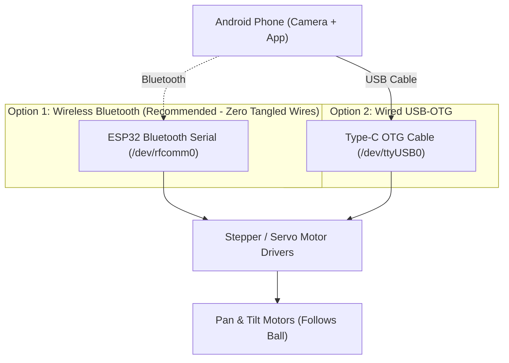
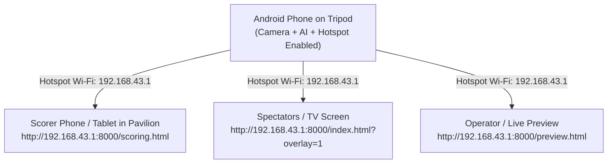

# Cricket Live — Android Deployment Guide (Plug & Play)

This guide explains how to run **Cricket Live** entirely on an Android phone (6 GB RAM, ARM64) with the built-in phone camera, pan/tilt motor control, auto-zoom, and continuous active learning.

---

## 1. System Architecture on Android

```text
Android Phone (6 GB RAM)
├── Phone Camera (via local loopback: http://127.0.0.1:8080/video)
├── Termux ARM64 Environment
│     ├── FastAPI Web & REST Server (port 8000)
│     ├── YOLOv8 Ball Tracking AI (native ARM64 CPU)
│     ├── Auto-Zoom & Pan/Tilt Error Calculator
│     ├── Continuous Active Learning & Frame Harvester
│     └── SQLite Realtime JSON Database
└── Hardware Connection (USB-OTG or Bluetooth)
      └── ESP32 Pan/Tilt Motor Rig (moves phone to follow the ball)
```

---

## 2. Prerequisites

1. **Android Smartphone:**
   - Android 10 or newer.
   - 6 GB RAM (YOLOv8 nano uses ~400 MB, FastAPI uses ~100 MB).
   - ~2 GB free storage space.
2. **Termux App:**
   - Download **Termux** from [F-Droid](https://f-droid.org/en/packages/com.termux/) (do **not** use Google Play version as it is deprecated).
3. **Local Camera Streamer App:**
   - Install **IP Webcam** (by Pavel Khlebovich) from Google Play or F-Droid to expose the phone's native camera sensor as a local loopback stream.

---

## 3. Step-by-Step Installation

### Step 1: Open Termux & Run

In the Termux terminal, run:

```bash
# 1. Grant storage permission (first time only)
termux-setup-storage

# 2. Navigate to your project folder
cd ~/Sports-Camera   # or your repository path

# 3. Launch Cricket Live (Auto-installs dependencies on first run!)
bash start_android.sh
```

> **Note:** If dependencies are not yet installed, `start_android.sh` will automatically detect this and run the full setup installer (`tools/setup_android.sh`) for you. You don't need to run setup separately unless you want to!

---

## 4. Plug & Play Camera Setup

Because Android security prevents non-root apps from opening camera hardware via raw Linux `/dev/video*`, the phone's camera is accessed at full speed through a local loopback.

1. Open the **IP Webcam** app on your phone.
2. (Optional) In *Video preferences*, set resolution to **1280x720** and FPS limit to **30** or **60**.
3. Scroll to the bottom and tap **Start server**.
4. IP Webcam will display: `http://127.0.0.1:8080` (or `http://192.168.x.x:8080`).
5. Leave IP Webcam running in the background.

Cricket Live is pre-configured to read `http://127.0.0.1:8080/video` automatically.

---

## 5. Attaching Motors to the Phone (Pan & Tilt)

You can connect the ESP32 pan/tilt motor rig to the phone in two ways:



### Option 1: Wireless via Bluetooth (Recommended)
1. Flash your ESP32 with standard Bluetooth Serial (`BluetoothSerial SerialBT; SerialBT.begin("Cricket-Gimbal");`).
2. On Android, open **Bluetooth Settings** and pair with `Cricket-Gimbal`.
3. In Termux, bind the device:
   ```bash
   rfcomm bind 0 <ESP32_MAC_ADDRESS>
   ```
4. Cricket Live automatically scans and connects to `/dev/rfcomm0`.

### Option 2: Wired via USB-OTG
1. Plug a standard USB-C OTG adapter into the phone.
2. Connect the ESP32 via USB cable.
3. The phone detects the serial port as `/dev/ttyUSB0` or `/dev/ttyACM0`.
4. Cricket Live automatically scans and connects to it.

---

## 6. Cricket Ground Setup: Mobile Hotspot (No Wi-Fi Router Needed!)

When playing on an open cricket ground with no Wi-Fi router, you can turn on your phone's **Mobile Hotspot**. Everyone on the ground can connect directly to your phone:



### How to use Hotspot on the ground:
1. Pull down your phone's notification shade and turn on **Mobile Hotspot** (or launch `./start_android.sh`, which automatically opens the Tethering settings for you).
2. Set your Hotspot network name (SSID), e.g., `Cricket-Camera`.
3. Have your scorer, commentators, or spectators connect their phones or laptops to the `Cricket-Camera` Wi-Fi.
4. On standard Android, your phone's Hotspot IP is **`192.168.43.1`**.
5. Anyone connected can immediately open their browser to:
   - **Main Dashboard:** `http://192.168.43.1:8000`
   - **Scorer Page:** `http://192.168.43.1:8000/scoring.html` *(Scorer can update runs/wickets from the pavilion!)*
   - **Live Preview + Auto Zoom:** `http://192.168.43.1:8000/preview.html`
   - **Score Overlay Graphic:** `http://192.168.43.1:8000/index.html?overlay=1`
   - **Or simply scan the QR Code** displayed right in the Termux terminal!

---

## 7. Starting the Application

Inside Termux, run:

```bash
bash start_android.sh
```

You will see:
```text
====================================================================
🏏 CRICKET LIVE — ANDROID MOBILE HOTSPOT & CONSOLE
====================================================================
📱 PHONE LOCAL ACCESS:
   http://127.0.0.1:8000

📶 HOTSPOT ACCESS (Anyone connected to your phone's Wi-Fi hotspot):
   • Main Dashboard:    http://192.168.43.1:8000
   • Scorer (Pavilion): http://192.168.43.1:8000/scoring.html
   • Live Preview HUD:  http://192.168.43.1:8000/preview.html
   • Live Score Overlay:http://192.168.43.1:8000/index.html?overlay=1

📱 SCAN TO CONNECT (Point any phone camera at this QR code):
[▄▄▄▄▄▄▄▄▄▄▄▄▄▄▄▄▄▄▄▄▄▄▄▄▄▄▄▄▄▄▄▄▄▄▄]
[█ ▄▄▄▄▄ █  █▄█  █▄█  █ ▄▄▄▄▄ █]
... (Terminal QR Code) ...
====================================================================
```

Open Chrome on your phone and navigate to:
```text
http://127.0.0.1:8000/preview.html
```

*(Scorers, commentators, or viewers on the field can connect to `http://<your-phone-ip>:8000` from their own phones or tablets!)*

---

## 7. Using All Features on Android

| Feature | How to Use on Android |
| :--- | :--- |
| **Live Camera Preview** | Tap **▶ Start Camera** to view the live video feed from the phone's camera. |
| **Auto Zoom & Ball Tracking** | Tap **🔍 Auto Zoom: OFF** → turns to **🔍 Auto Zoom: ON**. When the ball enters the pitch, the preview dynamically zooms in (1.5x–3.0x) and centers on the ball. |
| **Live Scorekeeping** | Open `http://127.0.0.1:8000/admin.html?view=scoring` to score ball-by-ball. Updates appear instantly on the live overlay. |
| **Continuous Learning** | Auto-harvesting runs in the background. Tap **Continuous Learning** in `training.html` to auto-train without losing older model capabilities. |
| **Broadcast Streaming** | Stream RTMP directly to YouTube or record 1080p MP4 to phone storage (`/recordings`). |

---

## 8. Performance Tips for Android

1. **Keep Termux in Background:**
   In Android Settings → Battery → Termux → Set to **Unrestricted** (prevents Android from putting Termux to sleep when screen turns off).
2. **Camera Resolution:**
   720p (`1280x720`) at 30 FPS is the sweet spot for maximum battery life and smooth 25+ FPS AI detection.
3. **Mounting:**
   Use a standard 1/4" tripod phone clamp mounted to your 2-axis stepper or servo bracket. Ensure cables have enough slack if using wired USB-OTG.
